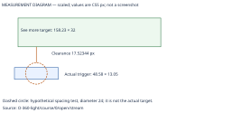

# R-024 — SC 2.5.8 target size and spacing assessment

**Scoped technical result:** Original stream triggers pass the spacing exception in the measured arrangements. Selected Demo B and selected R-023 stream triggers pass direct minimum size in every measured arrangement. Two original mobile upper-edge See more observations remain INCONCLUSIVE. No blanket WCAG conformance or failure is declared. **R-024 remains UNREVIEWED.**

[Measurement index](evidence/target-measurements.json) · [Version comparison](evidence/version-comparison.json) · [Spacing calculations](evidence/spacing-calculations.json) · [Closest pairs](evidence/closest-target-pairs.json) · [Gallery](GALLERY.md)

## A. What the original audit established

[S01 F-005, lines 318–335](../TASK_001/evidence/sources/S01_AUDIT.txt#L318) recorded approximately 48–49 × 13 px curriculum disclosure triggers, an authored padding/border reset and a touch/motor usability concern. Its explicit conformance limitation says adjacent spacing and exceptions were not measured: a **usability finding and conformance candidate**, not a definitive WCAG failure. [R-024 source, S01 line 148](../TASK_001/evidence/sources/S01_AUDIT.txt#L148) requests that missing assessment. R-022 is the selected minimum-size requirement; R-023 is the selected preferred full-badge implementation. Historical audit language and all owner decisions remain intact.

## B. Official rules and interpretation

The normative authority is [WCAG 2.2 SC 2.5.8](https://www.w3.org/TR/WCAG22/#target-size-minimum), Level AA: pointer targets need 24 × 24 CSS px unless an exception applies. For spacing, center a diameter-24 circle on each undersized target's bounding box; check that circle against other targets and against circles of other undersized targets. A center-distance-only check does not cover differently sized neighboring targets. Other exceptions concern a same-page equivalent function through a qualifying control, text-sentence/line-height constraints, unmodified browser-controlled sizing, or an essential/legally required presentation. A row of badges is not automatically inline text, and a shared navigation destination is not proof of equivalent functionality. No other exception is asserted here.

The informative [W3C Understanding guidance](https://www.w3.org/WAI/WCAG22/Understanding/target-size-minimum) explains the usable square: an axis-aligned solid 24px square must fit inside the target. Rounded corners and clipping can defeat a bounding-box-only check; a sufficiently wide pill can still contain that square. Visual decoration and focus rings do not enlarge the pointer area. Measurements use CSS coordinates, not physical pixels or a zoom workaround. Obscured content needs careful scope analysis; this report does not automatically exempt a disclosure partly covered by a persistent header.

## C. Read-only method and evidence scope

Chrome/156.0.8078.80; Windows headless at viewport height 1000, scale factor 1, widths 360/390/768/1024/1280/1440, light/dark, O/A/B. Source reconstruction is pinned to baseline 9d86db46b1134a3755a2e269252b1ee1234f2570 and accepted source snapshots at 426a1cebac9a617d7ef5ce27eeb2782aed2c70ee; owner decision parent is 3d3eea502b9bee612151fa3fbf75be878cd04d46. No source, CSS, markup, text, catalog entries or application data was altered. Only transient preview theme, focus, disclosure and scroll states were exercised.

36 page cases inventory 62 Course List stream triggers each. Inventories describe rendered layout, including offscreen entries, and do not classify every entry as hit-tested. The representative selection is first trigger at every width, plus distinct smallest-width, closest-ranked arrangement, longest existing Stream-5 label and last trigger at 360/1440. Deduplication avoids repeating the same representative. 78 representative selections produce 234 closed/open stream and visible See more observations. A further 24 upper/lower viewport arrangements add 72 observations. All 306 observations link to actual rectangles, shape models, clipping bounds, seven surface hit points, 676 centered-square sample points and neighboring controls; up to eight missed-point examples are retained with the full miss count. Centered-square misses outside a 13px target are expected, not new failures.

The analytical target model uses computed corner radii normalized to CSS edge sums, axis-aligned bounds and ancestor/viewport clipping. A direct PASS additionally requires all 676 square samples to hit that control. Unsupported complex geometry stays inconclusive. For spacing, circle-to-rectangle clearance uses the nearest point on every peer's bounding rectangle; undersized peers also get a second circle comparison. Rectangle overapproximation is conservative for a PASS, but an overlap alone is not sufficient to declare FAIL for a rounded/occluded shape. Borderline ±0.05px cases would remain inconclusive.

Native buttons/links/form controls and known actionable faculty spans are considered; viewport/scroller-excluded, hidden, disabled and pointer-events:none elements are recorded separately. Course-card bodies and department/credit/status/HP/SP/category labels without actions are not targets. See more is excluded while closed and measured while open. Nearby Edit/Remove buttons, visible navigation links and actual adjacent card disclosures are included. No multi-stream badge arrangement exists within one accepted fixture card; no fabricated arrangement is presented.

## D. Results and traceability

| Version / tested control | Main matrix | Upper/lower edge matrix | Conclusion |
|---|---|---|---|
| O original stream trigger | 52 spacing PASS | 16 spacing PASS | Undersized, but qualifies through measured spacing |
| O original visible See more | 26 direct PASS | 6 direct PASS; 2 INCONCLUSIVE | Upper mobile long-label overlap remains unclassified |
| A selected Demo B stream + See more | 78 direct PASS | 24 direct PASS | Direct minimum size for tested controls |
| B selected R-023 stream + See more | 78 direct PASS | 24 direct PASS | Direct minimum size for tested controls |
| Roadmap stream targets | Absent in all 36 fixture cases | Not fabricated | NOT TESTED — no matching control present |

Every observation and classification is indexed in [target-measurements.json](evidence/target-measurements.json), with full case files and [edge-measurements.json](evidence/edge-measurements.json). No specific unmet SC 2.5.8 requirement has been conclusively demonstrated. The absence of a FAIL is not a website-wide certificate.

Original measured stream widths span 47.828125–48.578125 px and heights 13.046875–13.046875 px; their height prevents a 24px square. A spans 47.828125–48.578125 × 24–24 px; B spans 63.828125–64.578125 × 26–26 px. A's inner target and B's full-badge target are distinct from their visual/focus outlines. All tested selected targets contain a usable square with zero sampled square misses. The actual pill, not its visual bounding box alone, was evaluated.

## E. Closest original spacing arrangement

The minimum measured original stream clearance is **17.5234375 CSS px**, observation **O-360-light/course/0/open/stream** ([case](evidence/cases/O-360-light.json)). Its radius-12 circle is centered at (172.1328125, 490.8828125). Nearest target: **See more**, rectangle x=151.84375, y=429.359375, width=158.234375, height=32. The nearest-point distance minus 12 gives the positive clearance. See more itself is large enough here, so no undersized-peer circle is needed for this pair. All other peer target/circle comparisons in the same observation are also recorded and positive.

[All closest pairs](evidence/closest-target-pairs.json) include closed arrangements, dense responsive card layouts, adjacent stream controls and both themes. Noninteractive labels immediately next to the stream badge do not invalidate spacing because they do not receive pointer actions. Neighbor controls matter, but the tested original circles do not intersect them. Rounded peer rectangles overapproximate the true shape, making these positive-clearance spacing conclusions conservative.

A stronger conservative check also passes: every original stream circle center is at least 29.5234375px from every peer target rectangle. Even if a partly clipped or rounded peer were undersized and its actual bounding-box center shifted anywhere inside that rectangle, its radius-12 circle still could not intersect the original radius-12 circle. Peer undersize flags in the raw calculation are model flags, not separate peer conformance certificates. This additional bound prevents those uncertainties from supplying an unsupported spacing PASS. Relevant control CSS contains no expanding pointer pseudo-target beyond the measured boxes.

## F. Original upper-mobile See more limitation

At 360px, both themes, the existing long Stream-5 disclosure opened with its trigger near y=220 overlaps the persistent header and extends horizontally. In the light sample its popup is x=167.84375, right=447.84375, while document client width is 345; the See more box is x=178.84375, y=163.3125, width=258, height=32. Its center is clickable, but **260 of 676** centered-square sample points hit the header instead. [Unmodified screenshot](screenshots/edges-O-360-light-upper.png), [edge record](evidence/edge-measurements.json).

A second read-only check searched **4848 candidate square placements per theme** inside the target/viewport, testing candidate boundaries and confirming a full grid for any promising placement; no usable 24px square was verified. [Overlap recheck](evidence/overlap-recheck.json). This does not prove that no possible continuous square or valid spacing/other exception exists. The exact remaining interactive shape, its bounding box and applicable obscuration/exception interpretation need further work before a definitive conformance classification. Hence **INCONCLUSIVE**, not FAIL. Demo B and R-023 avoid this overlap in the matching tested arrangements and pass directly. No repair was made.

## G. Other exceptions and limits

Spacing is the only exception relied upon. No alternative control was independently proven to implement the complete stream disclosure function and meet the criterion. The field filter shares part of See more navigation but does not itself establish an equivalent disclosure. These authored standalone buttons are neither sentence links nor controls whose size is constrained by neighboring prose; authored padding/font/border rules also prevent an unmodified-user-agent-size claim. No essential or legally required compact presentation was established.

43 roadmap cards render noninteractive categories such as GenEd; there are no roadmap stream buttons in the unchanged accepted fixture. Source inspection confirms the same renderCategoryBadge helper can serve roadmap/course-list branches, but shared code does not substitute for a tested real roadmap arrangement. [Roadmap screenshots](GALLERY.md) prove the fixture coverage limitation, not a new defect. Other real course data/programs, physical touch devices, Firefox/WebKit, spoken assistive technology, zoom/forced colors and all site controls are NOT TESTED. No circle-spacing matrix beyond the recorded accepted arrangements is inferred.

Fresh Windows archive exports use CRLF in text files while the Git blobs use LF. Source-content verification allows only this line-ending normalization and checks binary bytes exactly; raw source-copy hashes remain identical before/after. An initial byte-only guard rejected this export difference, and a subsequent Git show path hit a Windows filename-length limit. The final guard reads blobs by object ID and verifies content without changing source or Git settings. Both resolved verification attempts are recorded in TEST_RESULTS.txt.

The preview records blocked local maintenance-endpoint 403 responses and missing local favicon.ico 404 responses; these are isolated network diagnostics, not production requests. Browser runtime exceptions in final cases: zero. [Diagnostics](evidence/browser-diagnostics.json). Initial harness assumption of a roadmap trigger was corrected and preserved in [attempt log](evidence/harness-attempts.json). It caused no application edit.

## H. Owner evaluation and follow-up

The original 13px finding remains a demonstrated usability concern; measured stream arrangements now have positive spacing evidence instead of a height-only conformance allegation. R-023 remains appropriate as the owner-selected larger surface, retaining R-022 and other Demo B improvements; minimum conformance is not the only reason to prefer a larger target. No additional UI redesign is recommended by this assessment.

If a definitive result is required for the original obscured upper-mobile See more control, authorize a narrowly scoped visible-boundary/exception assessment; do not infer an automatic repair. Roadmap-specific certification needs an owner-approved representative dataset with actual roadmap stream buttons. Neither follow-up was implemented. R-024 stays UNREVIEWED; R-025 was not started. Original main, all source/demos, historical evidence, selections and 106 recommendation counts are protected. See [protection evidence](evidence/GIT_PROTECTION.json) and [test results](TEST_RESULTS.txt).
