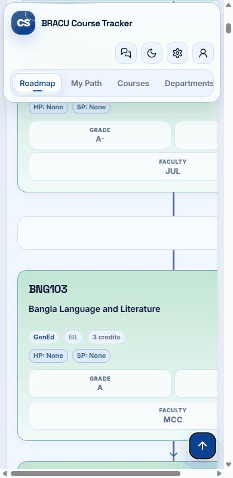
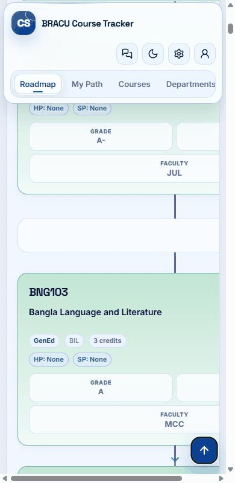

# R-029 · keyboard and pointer comparison

## Recorded Enter activation

390 × 800 CSS px, light theme, no motion preference. Both recordings start with keyboard focus on Back to Top. The original traverses the page. The candidate reaches the header on activation. These are actual Chrome screencast frames, shown with their recorded spacing rounded to GIF timing resolution. The last frame holds for 900 ms for reading. Each capture has its own start clock.

| Before · always smooth | After · keyboard instant |
| --- | --- |
|  |  |

[Source frame timestamps](evidence/screencasts/timing.json) · [Before interaction traces](evidence/traces/before-390.json) · [After interaction traces](evidence/traces/after-390.json)

## Position at activation and over time

The table uses the first actual animation frame at or after 100 ms from the scroll request. Times for the first zero frame include browser frame scheduling. A synchronous zero is visible directly in the call-return column. All positions are vertical CSS pixels.

| Version | Input | At call | At return | Frame near 100 ms (time, y) | First zero frame |
| --- | --- | ---: | ---: | --- | ---: |
| before | Enter | 1646 | 1646 | 105.4 ms, 1513 | 672.8 ms |
| after | Enter | 1646 | 0 | 102.8 ms, 0 | 6.3 ms |
| before | Space | 2446 | 2446 | 108.5 ms, 2303 | 812.8 ms |
| after | Space | 2446 | 0 | 111 ms, 0 | 1.6 ms |
| before | pointer | 896 | 896 | 102.7 ms, 711 | 503.5 ms |
| after | pointer | 896 | 896 | 102.6 ms, 711 | 489.4 ms |

## Focused and settled screenshots

Each cell opens an actual full-viewport capture from the Enter run. The initial capture is after Tab focus. The final capture is after reaching zero and hiding the arrow.

| Viewport / theme / motion | Before · initial / final | After · initial / final |
| --- | --- | --- |
| 390 × 800 / light / no-preference | [initial](evidence/screenshots/before-390-light-no-preference-Enter-initial.png) / [settled](evidence/screenshots/before-390-light-no-preference-Enter-settled.png) | [initial](evidence/screenshots/after-390-light-no-preference-Enter-initial.png) / [settled](evidence/screenshots/after-390-light-no-preference-Enter-settled.png) |
| 390 × 800 / dark / reduce | [initial](evidence/screenshots/before-390-dark-reduce-Enter-initial.png) / [settled](evidence/screenshots/before-390-dark-reduce-Enter-settled.png) | [initial](evidence/screenshots/after-390-dark-reduce-Enter-initial.png) / [settled](evidence/screenshots/after-390-dark-reduce-Enter-settled.png) |
| 1440 × 800 / light / no-preference | [initial](evidence/screenshots/before-1440-light-no-preference-Enter-initial.png) / [settled](evidence/screenshots/before-1440-light-no-preference-Enter-settled.png) | [initial](evidence/screenshots/after-1440-light-no-preference-Enter-initial.png) / [settled](evidence/screenshots/after-1440-light-no-preference-Enter-settled.png) |
| 1440 × 800 / dark / reduce | [initial](evidence/screenshots/before-1440-dark-reduce-Enter-initial.png) / [settled](evidence/screenshots/before-1440-dark-reduce-Enter-settled.png) | [initial](evidence/screenshots/after-1440-dark-reduce-Enter-initial.png) / [settled](evidence/screenshots/after-1440-dark-reduce-Enter-settled.png) |

The full timing matrix also covers 360, 768 and 1024 px, both themes and both preferences. [Matrix CSV](evidence/matrix.csv) · [Raw traces by width](evidence/traces) · [Report and limitations](TASK_REVIEW_005.md)
