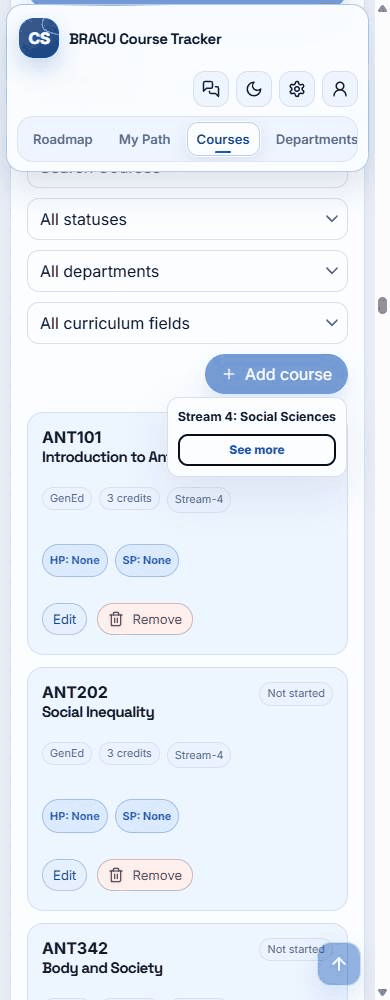
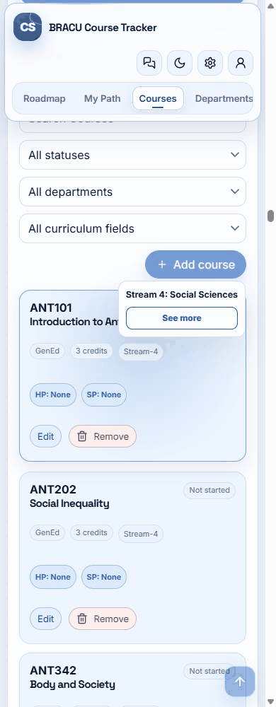
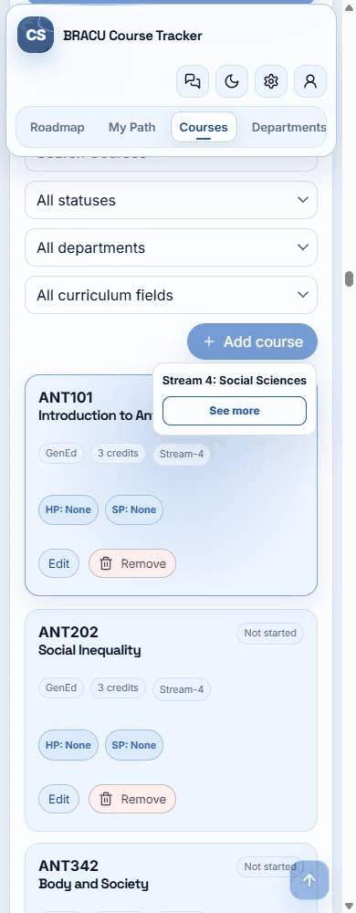

# R-030 recorded comparison

390 × 1000 CSS px, light theme, no motion preference, ANT101 / Stream-4. These are actual Chrome screencast frames, timed from capture timestamps rounded to GIF precision. The last frame holds for 900 ms. The recordings have independent start clocks.

| Action | Before · selected stream experience | After · R-030 candidate |
| --- | --- | --- |
| Enter |  |  |
| Space |  |  |
| pointer |  |  |

The first badge requires a small scroll. The difference can look subtle. Pointer remains smooth in both copies. [Frame timestamps](evidence/screencasts/timing.json) · [Full input and scroll matrix](evidence/matrix.csv)

## Position observations

| Version / width | Input / badge | Initial y | At scroll return | After focus | Final y | First near-final frame after request |
| --- | --- | ---: | ---: | ---: | ---: | ---: |
| before / 390 | Enter / first | 16324 | 16324 | 16324 | 16371 | 89.8 ms |
| after / 390 | Enter / first | 16324 | 16371 | 16371 | 16371 | 6.9 ms |
| before / 390 | Space / first | 16324 | 16324 | 16324 | 16371 | 86.3 ms |
| after / 390 | Space / first | 16324 | 16371 | 16371 | 16371 | 7.1 ms |
| before / 390 | pointer / first | 16324 | 16324 | 16324 | 16371 | 89.9 ms |
| after / 390 | pointer / first | 16324 | 16324 | 16324 | 16371 | 88.6 ms |
| before / 1440 | Enter / first | 7413 | 7413 | 7413 | 7711 | 273.3 ms |
| after / 1440 | Enter / first | 7413 | 7711 | 7711 | 7711 | 6.8 ms |
| before / 1440 | Space / first | 7413 | 7413 | 7413 | 7711 | 273.1 ms |
| after / 1440 | Space / first | 7413 | 7711 | 7711 | 7711 | 6.8 ms |
| before / 1440 | pointer / first | 7413 | 7413 | 7413 | 7711 | 273.5 ms |
| after / 1440 | pointer / first | 7413 | 7413 | 7413 | 7711 | 280 ms |
| before / 1440 | Enter / last, upper edge | 17768 | 10967 | 10967 | 7711 | 918.8 ms |
| after / 1440 | Enter / last, upper edge | 17768 | 7711 | 7711 | 7711 | 4.8 ms |

Each scroll targets the Course List start. Changing the result set can shorten the page and clamp the offset in the later-badge case. Focus uses preventScroll and does not add a second scroll. The final 1440 px screenshots show the shared partial header overlap on the selector.

## Starting, intermediate and final screenshots

The initial keyboard capture shows See more focus. Intermediate captures occur roughly 100 ms after dispatch. Final captures show the Course List and active selector.

| Viewport / theme / preference / input | Before | After |
| --- | --- | --- |
| 390 / light / no-preference / Enter | [initial](evidence/screenshots/before-390-light-normal-Enter-initial.png) / [intermediate](evidence/screenshots/before-390-light-normal-Enter-mid.png) / [final](evidence/screenshots/before-390-light-normal-Enter-final.png) | [initial](evidence/screenshots/after-390-light-normal-Enter-initial.png) / [intermediate](evidence/screenshots/after-390-light-normal-Enter-mid.png) / [final](evidence/screenshots/after-390-light-normal-Enter-final.png) |
| 390 / light / no-preference / Space | [initial](evidence/screenshots/before-390-light-normal-Space-initial.png) / [intermediate](evidence/screenshots/before-390-light-normal-Space-mid.png) / [final](evidence/screenshots/before-390-light-normal-Space-final.png) | [initial](evidence/screenshots/after-390-light-normal-Space-initial.png) / [intermediate](evidence/screenshots/after-390-light-normal-Space-mid.png) / [final](evidence/screenshots/after-390-light-normal-Space-final.png) |
| 390 / light / no-preference / pointer | [initial](evidence/screenshots/before-390-light-normal-pointer-initial.png) / [intermediate](evidence/screenshots/before-390-light-normal-pointer-mid.png) / [final](evidence/screenshots/before-390-light-normal-pointer-final.png) | [initial](evidence/screenshots/after-390-light-normal-pointer-initial.png) / [intermediate](evidence/screenshots/after-390-light-normal-pointer-mid.png) / [final](evidence/screenshots/after-390-light-normal-pointer-final.png) |
| 390 / dark / reduce / Enter | [initial](evidence/screenshots/before-390-dark-reduce-Enter-initial.png) / [intermediate](evidence/screenshots/before-390-dark-reduce-Enter-mid.png) / [final](evidence/screenshots/before-390-dark-reduce-Enter-final.png) | [initial](evidence/screenshots/after-390-dark-reduce-Enter-initial.png) / [intermediate](evidence/screenshots/after-390-dark-reduce-Enter-mid.png) / [final](evidence/screenshots/after-390-dark-reduce-Enter-final.png) |
| 390 / dark / reduce / Space | [initial](evidence/screenshots/before-390-dark-reduce-Space-initial.png) / [intermediate](evidence/screenshots/before-390-dark-reduce-Space-mid.png) / [final](evidence/screenshots/before-390-dark-reduce-Space-final.png) | [initial](evidence/screenshots/after-390-dark-reduce-Space-initial.png) / [intermediate](evidence/screenshots/after-390-dark-reduce-Space-mid.png) / [final](evidence/screenshots/after-390-dark-reduce-Space-final.png) |
| 390 / dark / reduce / pointer | [initial](evidence/screenshots/before-390-dark-reduce-pointer-initial.png) / [intermediate](evidence/screenshots/before-390-dark-reduce-pointer-mid.png) / [final](evidence/screenshots/before-390-dark-reduce-pointer-final.png) | [initial](evidence/screenshots/after-390-dark-reduce-pointer-initial.png) / [intermediate](evidence/screenshots/after-390-dark-reduce-pointer-mid.png) / [final](evidence/screenshots/after-390-dark-reduce-pointer-final.png) |
| 1440 / light / no-preference / Enter | [initial](evidence/screenshots/before-1440-light-normal-Enter-initial.png) / [intermediate](evidence/screenshots/before-1440-light-normal-Enter-mid.png) / [final](evidence/screenshots/before-1440-light-normal-Enter-final.png) | [initial](evidence/screenshots/after-1440-light-normal-Enter-initial.png) / [intermediate](evidence/screenshots/after-1440-light-normal-Enter-mid.png) / [final](evidence/screenshots/after-1440-light-normal-Enter-final.png) |
| 1440 / light / no-preference / Space | [initial](evidence/screenshots/before-1440-light-normal-Space-initial.png) / [intermediate](evidence/screenshots/before-1440-light-normal-Space-mid.png) / [final](evidence/screenshots/before-1440-light-normal-Space-final.png) | [initial](evidence/screenshots/after-1440-light-normal-Space-initial.png) / [intermediate](evidence/screenshots/after-1440-light-normal-Space-mid.png) / [final](evidence/screenshots/after-1440-light-normal-Space-final.png) |
| 1440 / light / no-preference / pointer | [initial](evidence/screenshots/before-1440-light-normal-pointer-initial.png) / [intermediate](evidence/screenshots/before-1440-light-normal-pointer-mid.png) / [final](evidence/screenshots/before-1440-light-normal-pointer-final.png) | [initial](evidence/screenshots/after-1440-light-normal-pointer-initial.png) / [intermediate](evidence/screenshots/after-1440-light-normal-pointer-mid.png) / [final](evidence/screenshots/after-1440-light-normal-pointer-final.png) |
| 1440 / dark / reduce / Enter | [initial](evidence/screenshots/before-1440-dark-reduce-Enter-initial.png) / [intermediate](evidence/screenshots/before-1440-dark-reduce-Enter-mid.png) / [final](evidence/screenshots/before-1440-dark-reduce-Enter-final.png) | [initial](evidence/screenshots/after-1440-dark-reduce-Enter-initial.png) / [intermediate](evidence/screenshots/after-1440-dark-reduce-Enter-mid.png) / [final](evidence/screenshots/after-1440-dark-reduce-Enter-final.png) |
| 1440 / dark / reduce / Space | [initial](evidence/screenshots/before-1440-dark-reduce-Space-initial.png) / [intermediate](evidence/screenshots/before-1440-dark-reduce-Space-mid.png) / [final](evidence/screenshots/before-1440-dark-reduce-Space-final.png) | [initial](evidence/screenshots/after-1440-dark-reduce-Space-initial.png) / [intermediate](evidence/screenshots/after-1440-dark-reduce-Space-mid.png) / [final](evidence/screenshots/after-1440-dark-reduce-Space-final.png) |
| 1440 / dark / reduce / pointer | [initial](evidence/screenshots/before-1440-dark-reduce-pointer-initial.png) / [intermediate](evidence/screenshots/before-1440-dark-reduce-pointer-mid.png) / [final](evidence/screenshots/before-1440-dark-reduce-pointer-final.png) | [initial](evidence/screenshots/after-1440-dark-reduce-pointer-initial.png) / [intermediate](evidence/screenshots/after-1440-dark-reduce-pointer-mid.png) / [final](evidence/screenshots/after-1440-dark-reduce-pointer-final.png) |

[Technical report and limits](TASK_REVIEW_006.md) · [Reproduce the comparison](PREVIEW.md)
